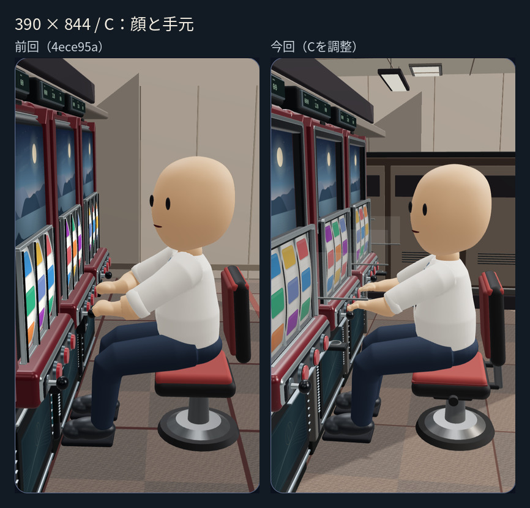
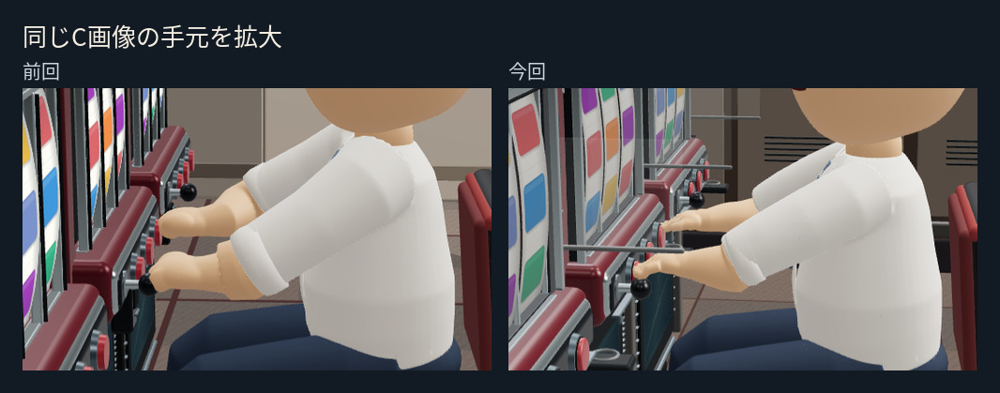
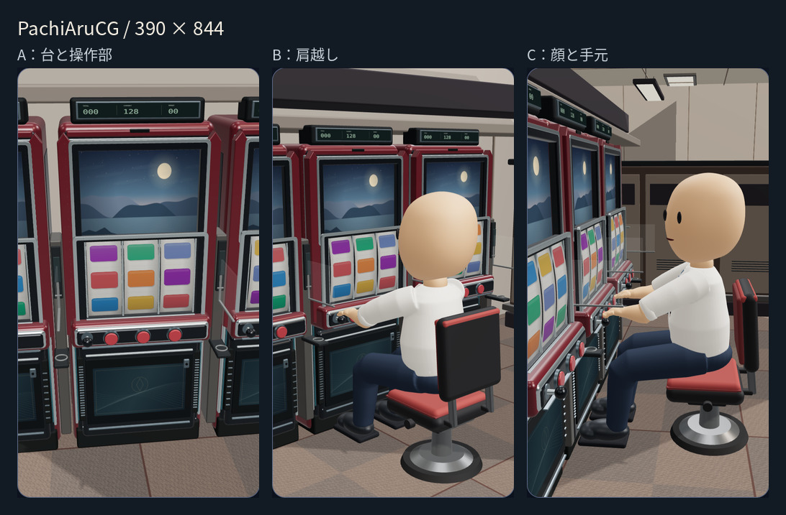
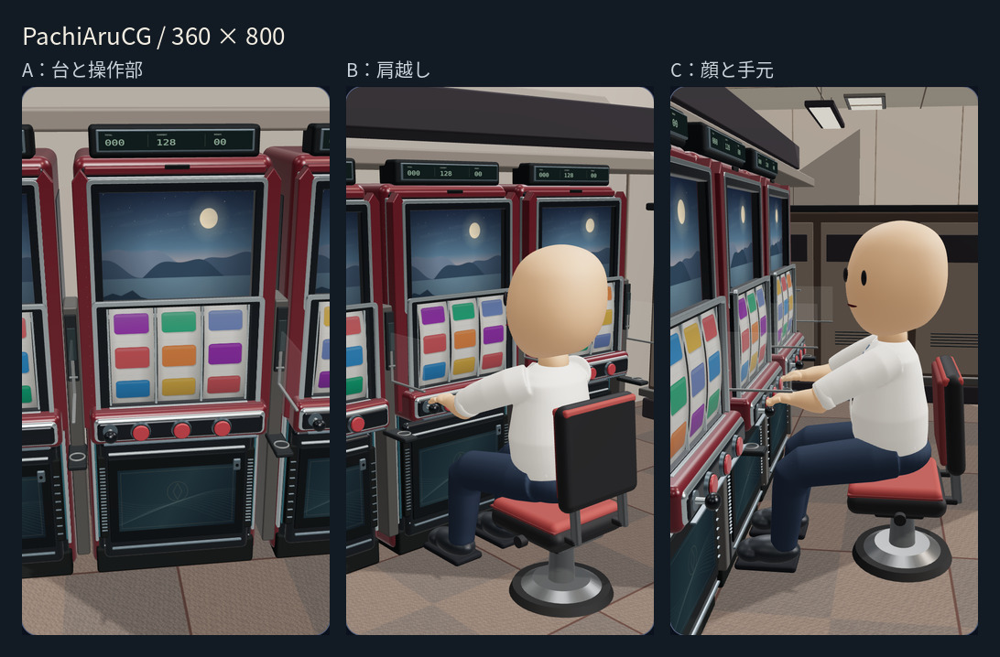
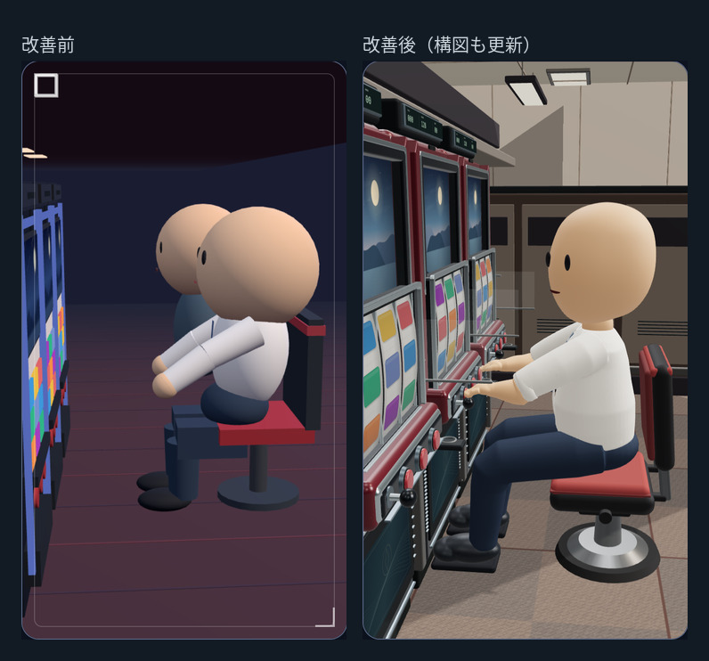

# PachiAruCG — ビジュアル確認

同じ人物・筐体をブラウザのWebGLで描画した実画像です。画像は比較用で、3Dプレビューの人物やアニメーション素材として読み込むことはありません。

まず元の制作ファイル37点を [`82017fc`](https://github.com/rrrtstudio/PachiAruCG/commit/82017fca0b2307526894df161d55760bf6de3015) に保存し、以後を追加コミットで改善しました。[保存した全ファイルとGLBハッシュ](RECOVERY.md)を確認できます。

## 今回：C「顔と手元」の改善前後

[360×800での前回・今回比較](images/360-c-study-comparison.jpg) ／ [前回画像の出典・ハッシュ](iterations/study-01/source.json)

左は前回PR #3の `4ece95a`、右は今回のブラウザ実描画です。造形に加えカメラと照明も調整した比較です。今回のA・B・Cは同じ人物GLB・同じ筐体を使い、視点ごとの造形変更はありません。

- 袖と前腕の断面を滑らかにし、薄い掌・丸い指・親指が分かる操作手へ調整。
- 指先を右ボタンの上半面、左手をレバー球に合わせ、手首を逆算。手の接点と筐体の表面座標を動作でも共有。
- 液晶・ガラス・内側の縁、曲面リール、操作デッキの厚みと金属・塗装の質感を調整。
- 椅子の背もたれ支柱、台間の設備・小棚・仕切り、落ち着いた別島の側面、天井の格子・照明を追加。
- 静止画では通常状態を使用し、告知ランプは消灯。周囲の設備に派手な発光は追加していません。

## 390 × 844

個別の大きい画像：[A：台と操作部](images/390-player.png) ／ [B：肩越し](images/390-behind.png) ／ [C：顔と手元](images/390-side.png)

## 360 × 800

個別の大きい画像：[A：台と操作部](images/360-player.png) ／ [B：肩越し](images/360-behind.png) ／ [C：顔と手元](images/360-side.png)

## 改善前後

旧版の画像は旧コードでブラウザ撮影し、[撮影元の記録](before/source.json)も保存しています。人物・筐体・照明・構図が変わっているため、同じカメラ位置の比較ではありません。

## 造形と動作

- 人物は約3MBのスキン付きGLB。17ボーンで同じモデルを変形し、両眼のまばたきと口の表情はモーフで補間。
- 白い衣服、肩・肘・手首、膝と靴を連続した曲面で造形。メガネは同一人物へのアクセサリー。
- 右・中央ボタンは右手、左ボタンは左手を使用。腕を伸張させず、2ボーンIKで操作位置へ寄せる。
- 首振り・驚き・落胆・平静への復帰で骨と表情を滑らかに動かし、停止時は骨・表情・遊技状態を保持。
- Aは台と操作部を見るインサートで人物・椅子を映さず、B・Cは同じ人物と台を描画。
- 台は架空のスマスロ形状。既存の通常3×3、横3つ揃い禁止、左中段チェリー禁止、当選・告知・7入賞の分離を維持。

動作中の撮影：[ボタン操作](images/390-play-paused.png) ／ [首振り](images/390-motion-look.png) ／ [落胆](images/390-motion-sad.png) ／ [平静へ](images/390-motion-pretend.png) ／ [メガネ](images/390-glasses-study.png)

遊技状態の実描画：[告知・7未入賞](images/390-bonus-notified.png) ／ [中央7入賞](images/390-bonus-aligned.png)。告知だけでは7図柄を揃えません。

## 検証結果

| 確認 | 結果 |
| --- | --- |
| JavaScript構文チェック | 合格 |
| 自動テスト | 49件合格（既存45件を維持し、操作接点の4件を追加） |
| 静止画 | 360×800・390×844、各3視点の計6枚 |
| モデルの同一性 | 各画面のA/B/Cで人物ID・筐体ID・ポーズ・接点・遊技状態が一致 |
| 操作位置 | 指先・握りの基準点と操作面の誤差、手首の到達誤差とも1mm未満。IKの到達制限なし |
| 動作 | 首振り・操作・落胆・平静へ復帰、停止・再開・静止復帰・メガネ切替に合格 |
| ブラウザ操作 | 360×800・390×844・1280×900で合格。9:16、横はみ出しなし、44px以上のカメラボタン |
| 遊技状態 | 告知→7入賞→消化→通常復帰を実描画で確認 |
| Pagesのパス構成 | `/PachiAruCG/` 配下で新しい操作座標モジュールを含む全18リクエスト200、描画成功（公開操作は未実施） |

撮影画像の目視では、Bで頭がリールを隠さず、Cで目・口と操作腕を確認できました。袖口・手首・腰・膝・靴に明確な分断や大きな貫通は見つかりませんでした。

## 確認方法

[比較用HTML](index.html)はリポジトリをHTTP(S)で配信した環境で開けます。3Dプレビューは初期状態が静止で、カメラを切り替えた後、動作ボタンから再生できます。「静止ポーズに戻す」で同じ造形確認ポーズに戻せます。

検証結果は [verification.json](verification.json)、再撮影方法は [README](../README.md) を参照してください。比較用静止画はピクセル比2、動作検証はピクセル比1です。前回のソフトウェア描画でピクセル比2の動作検証が時間制限に達したため、この条件を継続しています。前回の結果は [保存した検証記録](iterations/study-01/verification.json)で確認できます。実機Androidの速度・発熱までは確認していません。

今回のブランチは `visual/character-study`、PRはドラフトのまま保持します。main・公開済みGitHub Pagesへの反映や自動マージは行いません。画面を確認してから次の判断をお願いします。
